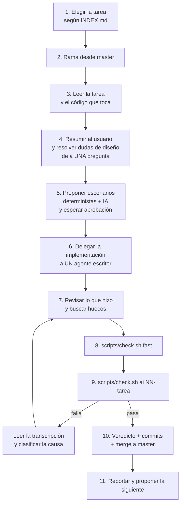

# Flujo de trabajo: construir las tareas de `implementar/`

> Documento de trabajo, sin versionar (igual que `e2e.md` e `implementar/`). Si arrancás una sesión nueva
> para seguir con las tareas, **leé esto primero**.

## Qué estamos haciendo

`implementar/` tiene las tareas (`01`…`21`, más la `13b`) que llevan a openrecord de "formato y CLI para
records" a "los records se implementan solos". `implementar/INDEX.md` tiene el mapa de dependencias.

Se construyen **de a una**, en orden de dependencias, y una tarea **solo se da por terminada cuando pasa
sus dos niveles de prueba**: los deterministas (Go) y los escenarios con IA (laboratorio `orlab`).

## Estado

| Tarea | Estado | Commits en `master` |
| --- | --- | --- |
| 01 · Anclas por nombre | ✅ | `a08fecc` `bb6b559` |
| 02 · Hash de integridad en JSON | ✅ | `d71699f` `759c859` |
| 03 · Escritura solo por el binario | ✅ | `c44fd99` `d54d987` |
| 04 · Spec `quality` | ✅ | `027902c` `ca6fbba` |
| 05 · Relaciones entre decisiones | ✅ | `3b0dbfb` `1ba2881` |
| 06 · Actores | ✅ | `feefe34` `d605f66` |
| 07 · Revisión de `concerns.md` | ✅ | `c2b9d84` `2c841aa` |
| 08 · Catálogo de verificación | ✅ | `90d9853` `09582eb` `56d3ce5` |
| 09 · Registro de checks | ✅ | `ca7e0d5` `2ea9046` |
| 10 · Anotaciones `@record:` | ✅ | `128801c` `dd7c2a9` `7079d76` |
| 11 · Sandbox | ✅ | `e1db210` `9ac36de` |
| 12 · Comando `impact` | ✅ | `a0cde7d` `c540f16` `d996aca` `098698f` |
| 13 · `impact --files` (era `plan`) | ✅ | `9eadfbb` `e863ddb` `3ad8b0b` |
| 13b · `check run` / `sandbox run` (era `verify`) | ✅ | `d330a78` `0eb7e42` |
| 14 · Registro de cumplimiento (`compliance`) | ✅ | `0b6a2da` `6c44ad9` |
| 15 · Ejecuciones (`run`, núcleo) | ✅ | `56e83f6` `df60190` |
| 16 · Skills onboard/capture/mine | ✅ | `ed4e5c0` `9949ec3` `0457d5d` `19e1968` `aaddd8d` `20f1f4b` `0eaee05` |
| 17 · Definir puntual **dentro de `capture`** (ya no skill `define`) | ✅ | `bf62f3c` `07b03db` |
| 18 · Skill `implement` | **pospuesta** por el usuario (hay que ajustar varias cosas antes); abierta: empaquetar los 5 roles como agentes propios (`.claude/agents/`) vs todo en la skill | — |
| 19 · Garantía con hooks | **en definición** | — |
| 20 – 21 | pendientes (20: worktree por run · 21: `roadmap`) | — |

Actualizá esta tabla al cerrar cada tarea.

## El ciclo de una tarea



### 1–2. Elegir y ramificar

- La siguiente es la de menor número cuyas dependencias (`Depende de`) estén todas hechas.
- Rama desde `master`: `feat/<algo>` para código, `docs/<algo>` para documentos. Nunca trabajar en
  `master` directamente.

### 3–4. Entender y resolver el diseño **antes** de escribir nada

- Leé `implementar/NN-*.md` y el código que va a tocar (CodeGraph primero). Verificá contra el código
  antes de afirmar algo.
- Abrí el tema con un **resumen corto** (qué resuelve, qué está decidido, qué falta), sin prosa compleja.
- Buscá activamente:
  - **contradicciones con lo ya decidido** en tareas anteriores (ver "Decisiones vigentes");
  - **huecos** que el documento no resuelve (casi todas las tareas tuvieron uno: cómo editar un registro
    en uso, qué archivos escanear, qué pasa con un campo que todavía no puede validarse…);
  - campos o comandos que apuntan a algo que todavía no existe (se posponen a la tarea que los crea).
- **Una pregunta por vez**, con una recomendación y su costo. Esperá la respuesta. Si el usuario no
  entiende, explicá con un ejemplo concreto en vez de repetir.
- Criterios de aceptación que no aplican (por ejemplo, "un decision record", porque el repo no tiene
  store propio) se dicen explícitamente y se dejan afuera.

### 5. Escenarios antes de implementar

Se escriben **al definir la tarea**, no después (si se escriben al final, se escriben para que pasen).

| Tipo | Dónde | Qué verifica |
| --- | --- | --- |
| Determinista | `e2e/<nombre>_test.go` (+ tests unitarios) | Valores exactos del binario: códigos, salidas JSON, archivos escritos o no |
| Con IA | `e2e-ai/scenarios/NN-<nombre>.md` (formato de `TEMPLATE.md`) | Que un agente nuevo, con las skills que se envían, use bien la feature |

El escenario con IA tiene: estado previo (` ```setup `), prompts (` ```prompt `), criterios por script
(` ```check `, `# Cn:`), criterios juzgados (`Jn`), señales de falla y log de veredictos. Reglas
aprendidas:

- Si se espera que el agente escriba un record, el **último prompt confirma** ("Looks right — go ahead
  and write it."): las skills piden confirmación antes de escribir.
- Un chequeo por script **solo mira lo que el agente ejecutó** (eventos `tool_use`), nunca el texto de
  toda la transcripción: ahí aparecen las skills que leyó.
- Lo que depende de cómo está **redactada** una respuesta va al juez, no a `grep`.
- Las rutas en disco llevan `.openrecord/` (`openrecord` muestra `specs/...` sin ese prefijo).

Presentá los escenarios al usuario y esperá su aprobación.

### 6. Delegar la implementación

Un solo agente escritor (`general-purpose`, modelo `sonnet`), en segundo plano. El brief incluye:

- leer primero: la tarea, y los archivos de los patrones a imitar (por ejemplo el de un registro
  anterior);
- las **decisiones tomadas** en la conversación, que pisan al documento de la tarea;
- los escenarios aprobados, textuales;
- restricciones fijas: no commitear; no tocar `implementar/`, `.atl/`, `.orca/`, `e2e.md`, `FLUJO.md`;
  **nunca referenciar `implementar/`** en código, docs, tests o skills (no está versionado: se nombra
  "task NN"); todo en inglés; sin `sudo`;
- actualizar **las skills que se envían** (`skills/`) cuando la feature cambia cómo trabaja un agente
  (lección de la 04: si la skill no lo explica, el escenario con IA falla);
  y si la feature responde a un pedido nuevo, **la `description` de la skill tiene que cubrirlo**: el
  agente decide si carga la skill solo por la descripción (lección de la 12);
- si agrega un registro JSON: `hash` (02), comandos `add/edit/remove` (03), mensaje del hook (03);
- el fixture `e2e/project` se regenera **solo** con `./e2e/seed.sh`;
- no correr el escenario con IA (lo corrés vos);
- reportar `<comando>: <resultado observado>`, archivos tocados y decisiones propias.

Si el agente queda cortado (fin de sesión), retomalo con `SendMessage` indicándole el estado del árbol.

### 7–8. Revisar y verificar

- Revisá el código clave, no solo el reporte. Huecos reales encontrados así: el hash que no detectaba
  un campo agregado a mano (02), la excepción del sandbox mal escrita (03), un error propio en un número
  del brief (08).
- `scripts/check.sh fast` (gofmt + vet + `go test ./...`). El hook `pre-commit` lo corre igual.
- Buscá referencias prohibidas: `grep -rn "implementar/" internal e2e e2e-ai docs skills`.

### 9. Escenario con IA

```
scripts/check.sh ai NN-<nombre>
```

Recompila e instala en `orlab` (incluidas las skills y la credencial de Claude), arma un proyecto nuevo
por corrida y juzga en dos partes. Los artefactos quedan en `e2e-ai/.runs/<run-id>/`.

**Si falla, leé la transcripción antes de culpar al agente.** Clasificá la causa:

| Causa | Ejemplo real | Qué se hace |
| --- | --- | --- |
| El chequeo está mal escrito | Ruta sin `.openrecord/` (01); `grep` multilínea (03); `actor add` encontrado en las skills (06) | Se corrige el chequeo |
| El escenario no contempla algo legítimo | El agente pidió confirmación y nadie respondió (06) | Se ajusta el escenario |
| Ambigüedad de diseño | `VERIFIED-IN`: ¿intención o hecho? (04); timeout obligatorio (11) | **Se le pregunta al usuario** |
| Bug del binario | La excepción del sandbox bloqueaba al propio binario (03) | Se corrige el código |
| Problema del laboratorio | Transcripciones guardadas dentro del proyecto (10) | Se corrige el runner |
| Conducta del agente | — | Se mejora la skill |

**Nunca se aflojan los criterios para que pase.** Cambiar un chequeo de script a criterio juzgado no es
aflojar: es cambiar quién evalúa.

### 10. Cerrar

- Agregar la línea de veredicto al escenario (`- AAAA-MM-DD: PASS — checked: x/y  judged: x/y. Run <id>. <versión de claude> as orlab.`).
- Commits en conventional commits, **sin `Co-Authored-By`**, con un cuerpo que explica el porqué:
  1. `feat(...)` / `docs(...)`: la feature (código + docs + skills + tests deterministas);
  2. `test(e2e-ai): accept <feature> through a fresh Claude session`: el escenario con su veredicto;
  3. arreglos colaterales aparte (`fix(e2e-ai)`, `chore`, `docs(...)`).
- `git switch master && git merge --ff-only <rama>`. **No hacer push** salvo que el usuario lo pida.
- Actualizar la tabla de "Estado" de este documento.

## Decisiones vigentes (pisan a los documentos de `implementar/`)

**Formato**
- Anclas: todo `### Scenario: <nombre>` de **cualquier** spec (incluida `quality`, nunca `[Qn]`) se ancla
  por slug (minúsculas, sin acentos vía NFD, todo lo demás a `-`). Transiciones de `lifecycle`:
  `<origen>-to-<destino>`. Un solo espacio de nombres por record. `duplicate-anchor`, `empty-anchor`.
- `VERIFIED-IN` declara **la intención** de cómo se verifica, aunque la prueba todavía no exista.
- Relaciones: `serves` y `depends-on` solo en decisiones; lo inverso se calcula. `record edit` devuelve
  `dependents` / `served_by`.
- `quality-unverified` se apaga con `VERIFIED-IN`, con un sandbox que lo `approximates`, o con un check
  que lo `enforces`.

**Registros JSON** (`components.json`, `actors.json`, `checks.json`, `sandbox.json`)
- Todos llevan `hash` y se verifican **byte a byte**; los comandos que escriben se niegan ante un archivo
  alterado (y `record edit` ante un `body-hash` roto). Sin migraciones: no hay usuarios todavía.
- Cada registro en uso necesita su `edit` (`actor edit`, `sandbox edit`); `check` no (nada lo referencia).
- `checks.json` guarda **solo lo que se comprueba con código**. Lo manual y lo estadístico van en el
  record (`VERIFIED-IN` en specs `quality`, prosa en decisiones). Sin campo de etapa.
- `sandbox.json`: `ready.timeout` en **segundos enteros** (default `60`), `logs.format` `json|text`
  (default `text`); los defaults se escriben en el archivo.

**Verificación**
- Vocabulario único de "dónde termina": `on-change` (check con `{files}`), `pre-merge` (check sin
  `{files}`), `pre-release` (medición automática antes de usuarios), `production`, `manual`.
- `openrecord verification [clave]` imprime el catálogo o una entrada recortada tal cual; sin `--json`.

**Protección (03)**
- `openrecord skills --emit <dir> --guard`: permisos + sandbox de procesos (`excludedCommands:
  ["openrecord *"]`) + hook. `git` **no** se exceptúa: restaurar o cambiar de rama sobre `.openrecord/`
  lo hace la persona.

**Anotaciones (10)**
- Se escanea lo que lista `git ls-files --cached --others --exclude-standard`, menos `.openrecord/` y
  `*.md`.

**Impact (12)**
- Salida **solo JSON** para la IA (medido contra Mermaid, prosa y triplas: JSON y triplas acertaron todo).
  `--human`, Mermaid y `--out` quedan "A futuro" en la tarea.
- Corre `validate` sobre todo el store antes; cualquier error lo hace negarse. Los avisos no bloquean.
- Solo vínculos declarados (nada de "mismo componente": eso es semántica, va a `reconcile`/`map`).
  Un salto, salvo `depends-on` en cadena en las dos direcciones (`depends_on` / `dependents`).
- Cada record listado: `path`, `status`, `description`. Secciones según el tipo de record.
  Vocabulario (unificado en la 13): `verified_by` (checks completos), `annotated_in`, `scenarios`
  (`{ancla: [file:line]}`), `verification` (por ancla de una quality).
- Una `rule` **sí** tiene anclas (sus escenarios); solo la decisión no tiene.

**Impact --files (13)** — no hay comando `plan`
- `impact --files a b c`: componentes = **todos** los que contienen el archivo (sin caso especial para
  `root`). Salida normalizada: `files` → componentes, `decisions` por componente, `specs` una vez cada
  una, checks dentro de cada record (medido: mejor para Haiku que checks por id; ⅓ de tokens que por archivo).
- `--only <secciones>` en los dos modos. Un argumento suelto es error, nunca se descarta.
- **Juicio se informa, lo mecánico lo hace cumplir el binario:** correr checks y sandboxes va a
  `verify` (13b), que da vuelta lo decidido en 09/11 ("el binario nunca corre checks ni sandboxes").
- `roadmap` (ex `plan --waves`) queda para después de la 14 y la 18.

**Correr checks y sandboxes (13b)** — no hay comando `verify`
- `check run <id> | --files a b [--per-change]` y `sandbox run <id> | --files a b`: misma cadena que
  `impact --files`; sandboxes elegidos por `observes`/`approximates`/`needs` de esos records, no por su
  `components`. Por defecto `check run` corre todo; `--per-change`, solo los de `{files}`. `{files}` nunca
  se completa con nada.
- El código de salida de `check run` es el veredicto; cada check sale solo `passed`/`failed` (sin salida).
  Un sandbox se levanta una vez para todos sus checks y `stop` corre siempre.
- Da vuelta 09/11: el binario **sí** ejecuta checks y sandboxes.

**Compliance (14)** — era "registro de implementación"
- `.openrecord/compliance/<ruta>.json`, versionado, un historial de eventos por record (`implemented`,
  `adopted`, `verified`, `blocked`) con `body-hash` y fecha que pone el binario. Estado calculado:
  `unknown` (nadie lo comprobó, no "sin implementar"), `up_to_date`, `outdated`, `blocked`.
- `verified_with` (⊆ checks, scenarios, sandbox, audit) en los eventos cumplidos; `blocked_by`
  (`pending`/`contradicts` con record, `missing` con nota) en vez de texto libre. Sin `by`.
- `possibly_stale` contra git desde el último commit del archivo de compliance, contando cada archivo
  solo en su componente **más específico** (si no, `root` = `.` lo marcaría todo).
- `compliance status [--files]` y `compliance log`; `impact` no cambia. `log` controla la forma, nunca
  la verdad. La skill `audit` ahora registra su resultado.

**Ejecuciones (15)** — núcleo
- Un run es una unidad de trabajo (alcance → entrega → PR), no una sesión. `.openrecord/runs/<id>/`,
  ignorado por git, hasheado, escrito solo por el binario, sin limpieza automática.
- `plan.json` (binario, fijo: la vara) ≠ `tasks.json` (definición: la IA propone con `run tasks set`, el
  binario hace cumplir cobertura, solo records del plan, lo `done` intocable, historial) ≠
  `tasks/<id>.json` (ejecución: estado, foto de `start`, y en `done` los archivos `modified`/`created`/
  `deleted` **deducidos de git**, nunca dados por el agente, más los checks).
- `run status` reporta el desvío del store contra la foto; nunca cambia el plan. Records mal o faltantes →
  huecos (`gap add`/`gaps`/`gap resolve`); cambiar el alcance → run nuevo.
- `--scope` acepta varias rutas; hoy es obligatorio (código preparado para calcularlo, tarea 21).
- **Diferido:** escribir en `compliance`, worktree (20), traza de lo consultado y restricción de
  lecturas (19), entregas, revisiones, hallazgos, líneas de base, reporte, `expected_files` (18).

**Skills (16)** — iteración 1
- `openrecord-bootstrap` → `openrecord-onboard`. Entrevista: componentes → actores → comportamiento
  (flow, process, rule, lifecycle) → decisiones (catálogo + "¿a qué spec sirve?" → `--serves`) →
  calidades; después de cada record, "¿cómo se verifica?".
- `component edit --title/--description` (no había cómo cambiar la descripción sin editar `INDEX.md`).
- Pregunta de origen hecha: en `capture` la resuelve el agente con `impact --files` (sin confirmación);
  en `mine` la propone con evidencia y la confirma la persona.
- **No hay skill `define`:** la 17 pasa a ser extender `capture` (la diferencia es de dónde sale el
  porqué, regla que `capture` ya tiene).
- Los controles que leen `serves` tienen que aceptar la forma en una línea (`serves: [a]`), que es como
  la escribe el binario.
- Escenarios de entrevista necesitan muchos turnos con las respuestas: la skill pregunta de a poco.

**Definir puntual (17)** — dentro de `capture`
- Dos situaciones: "terminé algo" (nadie confirma) y "quiero definir algo" (el porqué es de la persona o
  de un hueco: se propone título + una línea, nunca el cuerpo ni un resumen de él; el sí escribe
  `accepted`). Lo mismo para `actor/component/check/sandbox add`.
- En las **dos** situaciones, `reconcile` corre **sobre el borrador, antes de escribir** (`impact` sobre
  los `--serves`/`--depends-on` declarados, porque el borrador no existe en disco). No se revisa si el
  código ya cumple: el record nuevo queda `unknown` en `compliance`.
- Sin nada nombrado → `run gaps`. Por tipo: `missing` record nuevo; `pending` se **muestra el cuerpo**
  (única excepción: lo escribió otro) y `record edit --status accepted`; `contradicts` las dos partes y
  decide la persona. `gap resolve` devuelve las tareas a `pending` en el **mismo run**, sin `compliance`.

## Fuentes y cómo leerlas

- `implementar/NN-*.md`: el pedido de la tarea, ya reescrito como referencia de lo construido para las
  tareas cerradas (01–17, 13b); las pendientes (18–21) siguen siendo el pedido original, con sus notas
  "Decidido"/"Desde la NN" al día.
- `e2e.md`: explicación de la arquitectura de pruebas para el usuario.
- `e2e-ai/README.md` y `.claude/skills/openrecord-acceptance/`: cómo funciona el laboratorio.

## Laboratorio `orlab`

- Usuario Unix persistente, con Claude Code propio y nada de la configuración del desarrollador. `sudo`
  sin contraseña **solo** para actuar como `orlab` (`/etc/sudoers.d/openrecord-lab`).
- `e2e-ai/lab/refresh.sh` (lo corre `check.sh ai`) recompila, instala y **vuelve a copiar la credencial
  de Claude** del desarrollador (sin los tokens de MCP): un token copiado vence en cuanto rota.
- **Experimentos de formato** con `claude -p` como `orlab`: `--safe-mode --tools "" --disable-slash-commands
  --no-session-persistence`, y comprobar el aislamiento **por tokens** (~2.000 Sonnet / ~2.800 Haiku con
  "Reply OK"), nunca por lo que el modelo dice de sí mismo. Corregir respuestas por script.
- `bubblewrap` y `socat` están instalados (los necesita el sandbox de Claude Code de la 03).
- Si `orlab` no existe o `sudo -n -u orlab true` falla: `sudo bash e2e-ai/lab/setup.sh` (lo corre el
  usuario).

## Pendientes conocidos

- `OPENROUTER_API_KEY` renovada el 2026-10-23 y funcionando. `capture` ahora corre `reconcile`, que usa
  `search`: si vuelve a dar 401, fallan los escenarios de `capture`.
- Un fallo de `go test` no reproducido en la 17 (primera corrida de `check.sh fast`; dos corridas
  después, limpias). Si reaparece, buscar un test inestable.
- Las ramas de tareas ya integradas siguen existiendo localmente; se pueden borrar.
- `master` está adelante de `origin/master`: nada se subió.
- Garantía sin dueño todavía: que los cambios al store los apruebe una persona (CODEOWNERS / CI),
  anotada como candidata en la tarea 19.
- Pendientes de la 13b (anotados en `implementar/13b-comando-verify.md`): timeouts de checks y de los
  pasos del sandbox (heartbeat de 10 min + tope); guardar logs y salidas por id con un comando que los
  lea; `ready.log` (hoy solo `ready.http`).
- Códigos de salida: un error `usage` detectado dentro de un comando (argumento faltante, flag
  inexistente) sale con 1 en toda la CLI, aunque `docs/cli.md` dice 2. La 12 hizo salir con 2 solo
  `record-not-found` de `impact`. Arreglarlo aparte para todos los comandos.

## Cómo trabajar con el usuario

- Respuestas cortas y en español; una pregunta por vez, con recomendación.
- Verificar antes de afirmar; si algo resultó al revés de lo dicho, decirlo con la evidencia.
- No avanzar a implementar sin escenarios aprobados; no commitear ni mergear sin que el usuario haya
  aceptado el cierre de la tarea.
