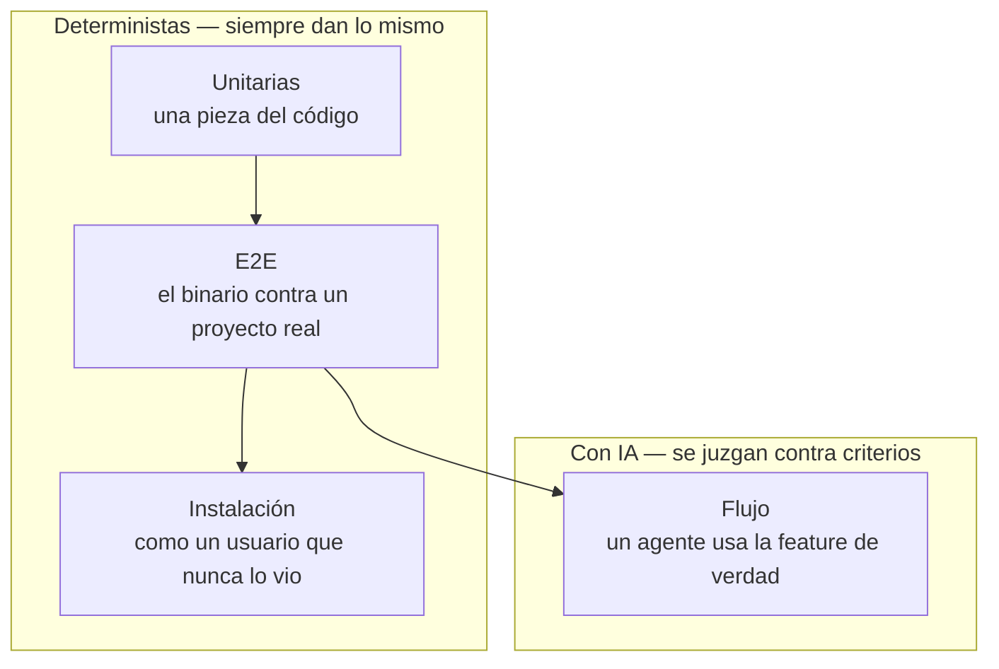
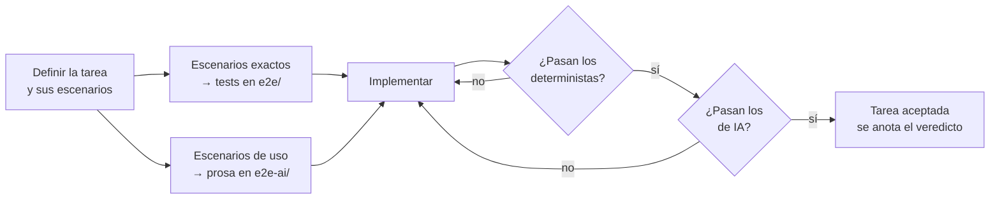
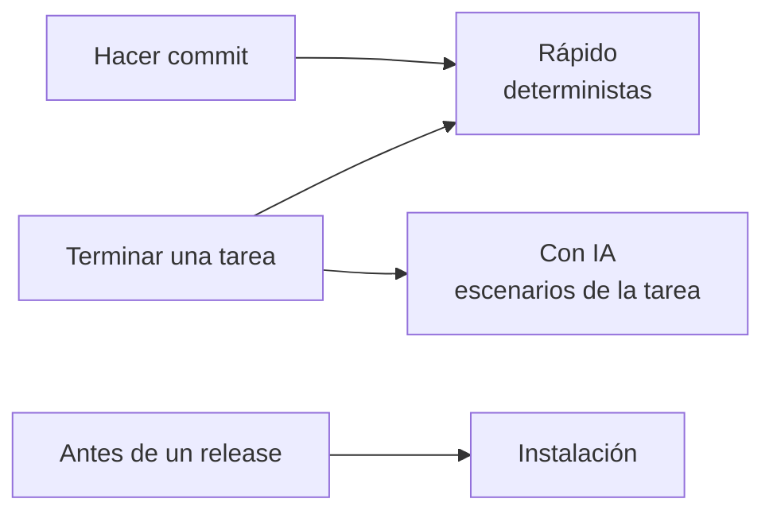
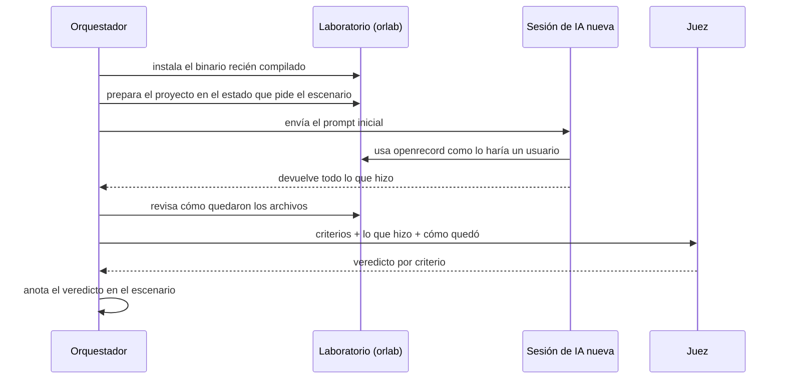
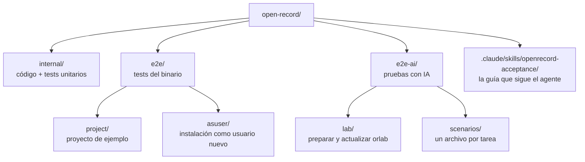
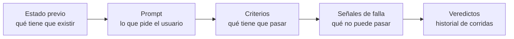

# Cómo se prueba openrecord

Una tarea no está terminada porque compila. Está terminada cuando se demostró dos cosas:

1. **Que funciona**: el binario hace exactamente lo que se decidió.
2. **Que sirve**: un agente de IA, usando las skills que se le entregan, la usa bien.

La primera se prueba con tests que siempre dan el mismo resultado. La segunda, con una sesión de IA real
a la que se le pide algo como lo pediría un usuario, y se juzga contra criterios escritos de antemano.

---

## Las cuatro capas

| Capa | Pregunta que responde | Dónde vive | Costo |
| --- | --- | --- | --- |
| Unitarias | ¿Esta pieza hace lo que dice? | `internal/` | segundos |
| E2E | ¿El binario cumple su contrato? | `e2e/` | segundos |
| Instalación | ¿Un usuario nuevo puede instalarlo? | `e2e/asuser/` | minutos, a veces |
| Flujo con IA | ¿Un agente lo usa bien? | `e2e-ai/` | minutos y tokens |

Las tres primeras atrapan **regresiones**: algo que andaba y dejó de andar. La cuarta atrapa lo que ningún
test puede ver: un mensaje confuso, una skill que no guía, un agente que edita a mano en vez de usar la
herramienta.

---

## El ciclo de una tarea

Los escenarios se escriben **cuando se define la tarea**, antes de implementar. No después: si se
escriben al final, se escriben para que pasen.

Cada escenario se reparte según **cómo se puede verificar**:

- Si la respuesta es un valor exacto (un código de error, un ancla, un archivo que no se escribió) → es un
  test determinista.
- Si la respuesta depende de cómo se comporta un agente (qué comando eligió, cómo explicó un error) → es un
  escenario de IA, escrito en prosa.

---

## Cuándo corre cada cosa

Todo es local. No hay nada en la nube.

Los deterministas son baratos y corren siempre. Los de IA son caros y su resultado no es idéntico entre
corridas, así que corren **solo antes de dar una tarea por terminada**: ni en cada commit ni antes de
hacer push.

---

## Cómo corre un escenario de IA

La prueba no la hace la misma sesión que implementó. La hace **otra sesión, limpia**, en un usuario aparte
del sistema (`orlab`) que no tiene ninguna de tus configuraciones personales. Así, si el agente usa bien
openrecord, es por mérito de openrecord y sus skills, no porque tu entorno lo empujó.

El juez trabaja en dos partes:

- Lo que se puede comprobar mirando archivos o salidas (el archivo tiene tal línea, el ancla es tal cosa)
  lo comprueba un script, sin IA.
- Lo que hay que interpretar (explicó el error citando lo que dijo la herramienta, no inventó nada) lo
  evalúa una IA separada, contra los criterios escritos.

Nunca se juzga por impresión: si un criterio no está escrito, no cuenta.

---

## Cómo está organizado

Un escenario de IA (`e2e-ai/scenarios/NN-tarea.md`) tiene siempre la misma forma:

---

## Qué existe hoy y qué falta

| Pieza | Estado |
| --- | --- |
| Tests unitarios y E2E | existen y corren con `go test` |
| Instalación como usuario nuevo | existe |
| Laboratorio `orlab` | existe y funciona |
| Primer escenario de IA (anclas), en el formato nuevo (chequeos + criterios juzgados) | existe |
| Un único comando que corre todo (rápido / con IA) | existe: `scripts/check.sh fast` / `scripts/check.sh ai` |
| El hook que corre los deterministas al hacer commit | existe: `.githooks/pre-commit` vía `core.hooksPath` |
| La sesión de IA corriendo sin pantalla, con registro completo | existe: `e2e-ai/run.sh` |
| El juez automático en dos partes | existe: chequeos por script + un `claude -p` juez aparte |
