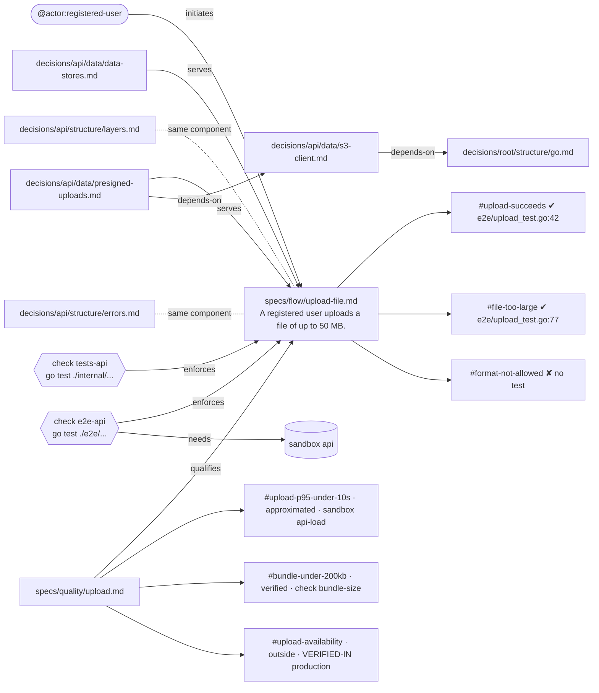

# Ejemplo de salida de `openrecord impact`

> Documento de trabajo, sin versionar. Muestra cómo **podría** verse la salida, para decidir el formato
> antes de implementar. Los datos son inventados, sobre un store de ejemplo.

Mismo record en todos los casos: `specs/flow/upload-file.md`. Lo conectado con él:

- lo inicia el actor `registered-user`;
- lo califica `specs/quality/upload.md` (tres escenarios de calidad);
- lo sirven dos decisiones, y una de ellas depende en cadena de otras dos;
- hay dos decisiones vecinas en el mismo componente (`api`);
- lo verifican dos checks, y uno de ellos necesita el sandbox `api`;
- tiene tres escenarios: dos con test y uno sin test;
- sus calidades están una aproximada, una verificada y una que se verifica fuera.

---

## 1. Vista para personas (`--human`)

```
$ openrecord impact specs/flow/upload-file.md --human

specs/flow/upload-file.md
  A registered user uploads a file of up to 50 MB.

initiated by     @actor:registered-user
qualified by     specs/quality/upload.md
                   #upload-p95-under-10s · #bundle-under-200kb · #upload-availability
served by        decisions/api/data/presigned-uploads.md
                   └─ depends on decisions/api/data/s3-client.md
                        └─ depends on decisions/root/structure/go.md
                 decisions/api/data/data-stores.md
same component   decisions/api/structure/layers.md
                 decisions/api/structure/errors.md
verified by      check tests-api   go test ./internal/...
                 check e2e-api     go test ./e2e/...        needs sandbox api
scenarios        upload-succeeds        ✔ e2e/upload_test.go:42
                 file-too-large         ✔ e2e/upload_test.go:77
                 format-not-allowed     ✘ no test
qualities        upload-p95-under-10s   approximated   sandbox api-load
                 bundle-under-200kb     verified       check bundle-size
                 upload-availability    outside        VERIFIED-IN production
```

---

## 2. Vista para la IA: opción **Mermaid** (tu propuesta)



Lo bueno: el grafo y la cadena `depends-on` quedan explícitos; se puede ver dibujado en GitHub.
Lo que cuesta: los atributos (cobertura, estado de cada calidad, comando del check) van **adentro de las
etiquetas** como texto libre, y un script no puede leerlos sin parsear Mermaid.

---

## 3. Vista para la IA: opción **JSON** (la convención actual del CLI)

```json
{
  "record": "specs/flow/upload-file.md",
  "description": "A registered user uploads a file of up to 50 MB.",
  "initiated_by": ["registered-user"],
  "qualified_by": [
    { "path": "specs/quality/upload.md",
      "anchors": ["upload-p95-under-10s", "bundle-under-200kb", "upload-availability"] }
  ],
  "served_by": [
    { "path": "decisions/api/data/presigned-uploads.md",
      "depends_on": [
        { "path": "decisions/api/data/s3-client.md",
          "depends_on": [ { "path": "decisions/root/structure/go.md", "depends_on": [] } ] }
      ] },
    { "path": "decisions/api/data/data-stores.md", "depends_on": [] }
  ],
  "same_component": ["decisions/api/structure/layers.md", "decisions/api/structure/errors.md"],
  "verified_by": [
    { "check": "tests-api", "command": "go test ./internal/..." },
    { "check": "e2e-api", "command": "go test ./e2e/...", "needs": "api" }
  ],
  "scenarios": [
    { "anchor": "upload-succeeds", "covered_by": ["e2e/upload_test.go:42"] },
    { "anchor": "file-too-large", "covered_by": ["e2e/upload_test.go:77"] },
    { "anchor": "format-not-allowed", "covered_by": [] }
  ],
  "qualities": [
    { "anchor": "specs/quality/upload.md#upload-p95-under-10s", "state": "approximated", "by": "sandbox api-load" },
    { "anchor": "specs/quality/upload.md#bundle-under-200kb", "state": "verified", "by": "check bundle-size" },
    { "anchor": "specs/quality/upload.md#upload-availability", "state": "outside", "by": "VERIFIED-IN production" }
  ],
  "broken": []
}
```

---

## 4. Vista para la IA: opción **prosa relacional**

```
specs/flow/upload-file.md — A registered user uploads a file of up to 50 MB.

It is initiated by @actor:registered-user.
It is qualified by specs/quality/upload.md.
It is served by decisions/api/data/presigned-uploads.md and decisions/api/data/data-stores.md.
decisions/api/data/presigned-uploads.md depends on decisions/api/data/s3-client.md.
decisions/api/data/s3-client.md depends on decisions/root/structure/go.md.
It shares component api with decisions/api/structure/layers.md and decisions/api/structure/errors.md.
It is verified by check tests-api (go test ./internal/...).
It is verified by check e2e-api (go test ./e2e/...), which needs sandbox api.
Scenario upload-succeeds is covered by e2e/upload_test.go:42.
Scenario file-too-large is covered by e2e/upload_test.go:77.
Scenario format-not-allowed has no test.
Quality upload-p95-under-10s is approximated by sandbox api-load.
Quality bundle-under-200kb is verified by check bundle-size.
Quality upload-availability is verified outside the repository, in production.
```

---

## 4b. Vista para la IA: opción **lista de triplas**

Dos bloques: una línea por vínculo (`sujeto relación objeto`) y una línea por nodo con sus atributos
(`nodo: clave=valor`). Los nodos que no son records llevan prefijo de tipo (`actor:`, `check:`,
`scenario:`, `quality:`). La cadena `depends-on` no se anida: son líneas sueltas que se encadenan.

```
actor:registered-user initiates specs/flow/upload-file.md
specs/quality/upload.md qualifies specs/flow/upload-file.md
decisions/api/data/presigned-uploads.md serves specs/flow/upload-file.md
decisions/api/data/data-stores.md serves specs/flow/upload-file.md
decisions/api/data/presigned-uploads.md depends-on decisions/api/data/s3-client.md
decisions/api/data/s3-client.md depends-on decisions/root/structure/go.md
decisions/api/structure/layers.md same-component specs/flow/upload-file.md
decisions/api/structure/errors.md same-component specs/flow/upload-file.md
check:tests-api verifies specs/flow/upload-file.md
check:e2e-api verifies specs/flow/upload-file.md
check:e2e-api needs-sandbox api
specs/flow/upload-file.md has-scenario scenario:upload-succeeds
specs/flow/upload-file.md has-scenario scenario:file-too-large
specs/flow/upload-file.md has-scenario scenario:format-not-allowed
specs/quality/upload.md has-quality quality:upload-p95-under-10s
specs/quality/upload.md has-quality quality:bundle-under-200kb
specs/quality/upload.md has-quality quality:upload-availability

specs/flow/upload-file.md: description="A registered user uploads a file of up to 50 MB."
check:tests-api: command="go test ./internal/..."
check:e2e-api: command="go test ./e2e/..."
scenario:upload-succeeds: covered_by=e2e/upload_test.go:42
scenario:file-too-large: covered_by=e2e/upload_test.go:77
scenario:format-not-allowed: covered_by=none
quality:upload-p95-under-10s: state=approximated by="sandbox api-load"
quality:bundle-under-200kb: state=verified by="check bundle-size"
quality:upload-availability: state=outside by="VERIFIED-IN production"
```

---

## Resultado del experimento (Claude limpio en `orlab`, 48 llamadas, corregido por script)

| Formato | Aciertos | Tokens de entrada (vecindario grande, Sonnet) |
| --- | --- | --- |
| JSON | 100% en 16/16 combinaciones | 4758 |
| Triplas | 100% en 16/16 combinaciones | 4814 |
| Mermaid | 93–97% en 2/16 | 4424 |
| Prosa | 93% en 2/16 | 4092 |

Las cadenas `depends-on` no le costaron a ningún formato. Los fallos de Mermaid y prosa fueron de
atributos escritos como texto corrido (confundir `approximated` con no verificado). Muestra chica
(n=3 por celda), con techo en 100%.

---

## 5. Flag opcional para guardar un `.md`

```
$ openrecord impact specs/flow/upload-file.md --out impact-upload-file.md
```

- Imprime lo mismo de siempre en stdout **y además** escribe el archivo.
- El `.md` lleva un título, la descripción del record y el bloque en el formato elegido (si es Mermaid,
dentro de un bloque ````mermaid` para que se dibuje en GitHub o en el editor).
- Se combina con `--human`: `--human --out x.md` guarda la vista para personas.
- Se niega a escribir dentro de `.openrecord/` (ahí solo escribe el binario, por sus propios comandos).

