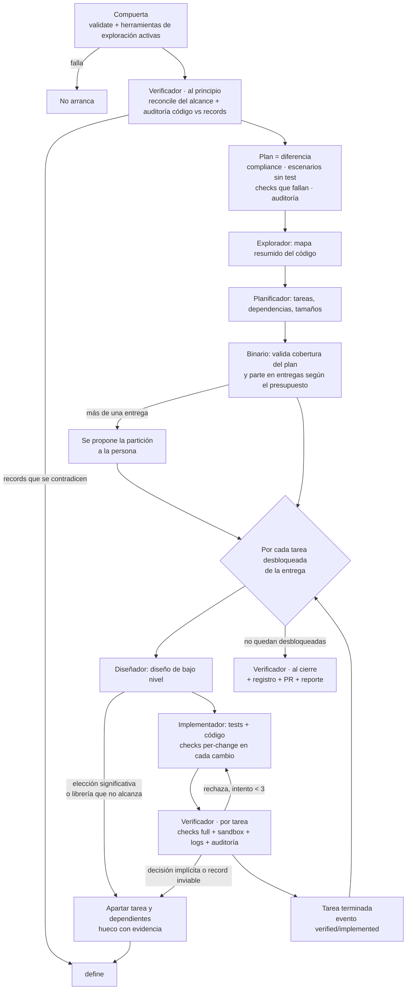

# 18 · Skill `openrecord-implement`

| Campo | Valor |
| --- | --- |
| Depende de | 03, 09, 10, 11, 13, 14, 15, 17 |
| Habilita | — |
| Costo | Alto |
| Valor | Alto |
| Tipo | Skill |

## Contexto

Todas las piezas anteriores — el formato extendido, los registros de verificación, el vecindario, el
plan de verificación (`impact --files`), el registro de cumplimiento (`compliance`), las ejecuciones —
existen para alimentar una sola cosa: un flujo
que lleve los records al código **sin intervención humana durante la ejecución**. No propone, no
especifica ni decide; calcula la diferencia entre records y código, la parte en tareas, las diseña, las
implementa y las verifica. La persona interviene antes (definiendo lo que hace falta) y al final
(aprobando el PR, o resolviendo los huecos que el flujo dejó).

Esto no es el ciclo clásico de especificar-diseñar-implementar con fases que inventan la definición
*durante* el trabajo. Con un store completo, inventar sobre la marcha sobra: la spec y la decisión ya
existen antes de que el flujo arranque. Lo que este flujo hace es la parte que sí falta — calcular qué
falta, diseñar cómo implementarlo, escribirlo y verificarlo — con una regla que no se negocia: si hace
falta decidir algo que nadie decidió, el flujo nunca decide por sí mismo; se aparta como un hueco y lo
resuelve una persona con `capture`, extendida para definir puntual (issue 17).

Esta es la skill orquestadora: la que la persona invoca ("implementá `specs/flow/carrito`") y la que
lanza a los demás agentes, porque solo el host que ejecuta agentes puede correr más de uno.

## Qué debe hacer

1. Correr una compuerta de arranque antes de hacer nada: el store tiene que validar sin errores, y las
   herramientas de exploración de código y de documentación que usan los agentes tienen que estar
   activas — son dependencias duras, no recomendaciones.
2. Fijar el alcance de la ejecución al lanzar (una oleada, un grupo, o un record puntual) y no cambiarlo
   nunca durante la ejecución.
3. Coordinar cinco subagentes — explorador, planificador, diseñador, implementador, verificador — cada
   uno con su momento y sus herramientas, con una regla fija: el verificador usa un modelo distinto del
   implementador.
4. Implementar las tres capas de verificación (determinística, no determinística, observación en
   runtime) en los tres momentos del verificador (al principio, por tarea, al cierre).
5. Resolver cada tipo de inconsistencia según la tabla de esta issue, apartando solo lo afectado y nunca
   decidiendo por cuenta propia.
6. Cerrar cada ejecución con un único PR por entrega, con el reporte en su descripción.

## Diseño

### La compuerta de arranque

No exige decisiones de antemano: solo revisa lo que no fuerza a nadie a decidir nada todavía.

| Revisa | Si falla |
| --- | --- |
| El store valida sin errores (sin referencias rotas, bien formado) | No se implementa: primero se arregla el store |
| Las herramientas de exploración de código y de documentación de librerías están activas | No arranca, y dice cuál falta |

Los records `pending` no frenan la compuerta entera: bloquean solo las tareas que de verdad dependen de
ellos, más adelante en el flujo.

**Por qué no exige una lista fija de decisiones base** (lenguaje, capas, almacenamiento, estrategia de
tests) antes de arrancar: forzaría a decidir cosas que tal vez el proyecto no necesita decidir todavía.
El flujo ya sabe qué hacer cuando falta una decisión — la trata como un hueco en el momento en que una
tarea de verdad la necesita. Si ninguna tarea la necesita, la ausencia nunca se nota, y exigirla de
antemano solo cambiaría *cuándo* se frena (antes de empezar, en vez de en la primera tarea que la
necesita), sin cambiar el resultado. Es la misma lógica detrás de no exigir que toda spec tenga una
herramienta que la verifique: una spec sin check aparece como "sin herramienta" en el plan, que es
trabajo pendiente, no un motivo para no arrancar.

### Alcance: fijado al lanzar, nunca después

| Cómo se lanza | Qué hace el orquestador |
| --- | --- |
| **Con alcance** (una oleada, un grupo, o un record puntual) | Pide al binario que revise las dependencias de ese alcance; si falta algo, pregunta si se incluye o si primero se implementa lo que falta |
| **Sin alcance** | Pide la hoja de ruta (`roadmap`, issue 21) y propone la próxima oleada pendiente |

```
specs/flow/carrito.md depende de:
  specs/lifecycle/pedido.md       ✘ sin implementar (oleada 1)
¿Lo incluyo en el alcance, o primero corrés la oleada 1?
```

Una vez fijado, el orquestador no lo cambia: no agrega records, no salta a la oleada siguiente, no
amplía el alcance para resolver un hueco. El PR contiene exactamente lo acordado, y la persona decide al
principio y al final, nunca en el medio.

### Los cinco roles

| Rol | Cuándo | Qué hace | Herramientas |
| --- | --- | --- | --- |
| **Explorador** | Una vez por ejecución | Mapea el código: qué existe, dónde cae cada punto del plan, qué depende de qué. Entrega un mapa resumido | Exploración de código |
| **Planificador** | Una vez, en la primera ejecución de una serie de entregas | Con el plan del binario y el mapa del explorador: tareas, dependencias, tamaño estimado de cada una | El mapa del explorador |
| **Diseñador** | Por tarea, antes de implementar | Diseño de bajo nivel: archivos, funciones, interfaces, llamadas a librerías | Exploración de código, documentación de librerías, paquete de la tarea |
| **Implementador** | Por tarea, con contexto limpio | Escribe tests y código siguiendo el diseño | Diseño de la tarea + plan de verificación |
| **Verificador** | Tres momentos, cada uno con contexto limpio | Juzga el código contra los records | Checks, salida del sandbox, revisión del código, el vecindario |

**Solo el implementador escribe código; nadie escribe records** (issue 03). Quien juzga es siempre
distinto de quien escribe.

**Modelos por rol:** configurables del lado del host que ejecuta los agentes (no del binario, que nunca
corre agentes), con una regla obligatoria: **el verificador usa un modelo distinto del implementador**,
para que quien juzga no comparta los puntos ciegos de quien escribió.

### El verificador en sus tres momentos

| Momento | Qué audita | Qué busca |
| --- | --- | --- |
| **Al principio** | Los records del alcance, entre sí y contra el código actual | Records que se contradicen; código que ya contradice un record |
| **Por tarea** | El código de la tarea contra su diseño y sus records, más la salida del sandbox | Si cumple; si se coló una decisión implícita |
| **Al cierre** | Todo lo implementado junto | Tareas correctas por separado que chocan entre sí |

### Qué recibe el implementador

| Recibe | De quién | Responde |
| --- | --- | --- |
| Diseño de la tarea | El diseñador | **Cómo** implementarlo |
| Plan de verificación (`impact --files`, issue 13) | El binario | **Contra qué se lo mide**: records, comandos, escenarios sin test, `pending` |

El diseño es el camino; el plan es la vara.

### El flujo completo



### Forma de una tarea

| Parte | Sale de |
| --- | --- |
| Objetivo | Los escenarios de las specs que tienen que pasar |
| Restricciones | Las decisiones que gobiernan esos archivos |
| Terminado | Los checks (`per-change` y `full`), la cobertura de escenarios, la salida limpia del sandbox, y la auditoría |

El paquete de cada tarea lo arma el binario (`impact --files`, issue 13): rutas, descripciones, comandos,
escenarios sin test. El orquestador le pasa al implementador solo lo que corresponde a su tarea, nunca
el plan completo.

### Definición de terminado, por tarea

- Pasan todos los checks, incluidos los que necesitan un sandbox levantado.
- Cada escenario que toca la tarea tiene un test anotado (issue 10).
- La revisión de la salida del sandbox no encontró anomalías.
- El verificador no encontró contradicciones ni decisiones implícitas.
- **Intentos acotados a 3.** Después de 3 rechazos del verificador, la tarea se aparta como bloqueada.
  Con menos, se apartarían tareas que se corregían en el intento siguiente; con más, si no convergió es
  raro que converja, y crece el riesgo de que el implementador "arregle" debilitando los propios tests.
- **Cada rechazo queda guardado** en la ejecución (issue 15): el contador en `tasks.json` (`attempts`) y
  el detalle en `reviews/<tarea>-<n>.json`, con cada motivo, su fuente (checks, salida del sandbox,
  auditoría), la evidencia y el record. El implementador lo recibe en el siguiente intento; al llegar a
  3, `compliance` (issue 14) recibe un evento `blocked` con su `blocked_by`, y el reporte del
  PR lo muestra.

### La capa de verificación: comparar cobertura, no líneas

Al cerrar cada tarea, se compara — con control de versiones, contra el inicio de la tarea — qué
escenarios y records quedan cubiertos por anotaciones (issue 10), nunca cuántas líneas cambiaron:

| Cambio en la cobertura | Qué pasa |
| --- | --- |
| Ninguno pierde cobertura (agregar, mover un test, refactorizar) | Pasa solo |
| Uno pierde cobertura sin declarar | La tarea no cierra |
| Uno pierde cobertura declarada y confirmada por el verificador (corregir una anotación mal puesta por una tarea anterior) | Pasa, queda registrado en la ejecución y en el reporte, y el escenario vuelve como pendiente si la tarea no lo cubrió |

Los cambios dentro de la misma tarea no cuentan: se compara siempre contra el inicio de la tarea.
Anotar un test que no prueba lo que anota no se detecta de forma mecánica — eso lo revisa el verificador
en cada anotación nueva, como parte de la auditoría por tarea.

### Tabla de inconsistencias: qué se hace y cuándo se detecta

El flujo nunca resuelve una inconsistencia eligiendo él. Si el record es claro, se corrige el código; si
resolverla exige decidir algo, se aparta y decide una persona. Siempre se aparta solo lo afectado.

| Inconsistencia | Cuándo se detecta | Qué hace el flujo |
| --- | --- | --- |
| El código contradice un record | Al principio (checks + auditoría) | Corrige el código: entra al plan como una tarea más |
| Dos records se contradicen | Al principio (reconciliación) | No elige: aparta las tareas afectadas y reporta el par |
| El código hace algo que ningún record dice | Al principio (explorador) | No lo borra ni escribe un record: lo reporta para reconstrucción o definición posterior, y sigue |
| El record es inviable (la librería no lo soporta) | En el diseño, o al implementar | No lo parchea: hueco con evidencia, a definición |
| Una elección significativa que nadie decidió | En el diseño | Hueco: a definición, que escribe el record |
| Una elección de código local, barata de revertir | En el diseño | La resuelve el diseñador; queda documentada en el diseño de la tarea |
| El implementador decidió algo que nadie decidió | Al final de la tarea (verificador) | Descarta el código de la tarea: reintenta sin esa elección, o hueco |

### Ante un hueco: se sigue, el grafo decide

Se aparta la tarea y sus dependientes, se sigue con las independientes, y la ejecución termina sola
cuando no queda ninguna tarea desbloqueada. Un hueco en el esqueleto frena casi todo de inmediato; uno en
una capacidad aislada, solo esa rama. "Parar en el primer hueco" queda como modo opcional para
ejecuciones supervisadas, no como comportamiento por defecto.

El hueco queda en los artefactos de la ejecución (issue 15) y lo toma la skill de definición (issue 17).
Un record `pending` bloquea solo las tareas que dependen de él, nunca la ejecución entera.

**Que pase cada vez menos:** si un tipo de hueco se repite entre ejecuciones, falta una pregunta en
`openrecord-onboard` o en la extensión de `capture` para definir puntual, no una regla nueva en este
flujo.

### Tres escenarios, un mismo flujo

| Escenario | La diferencia es | Qué hace |
| --- | --- | --- |
| Desde cero | Todos los records | Oleadas en el orden topológico de `roadmap` (issue 21) |
| Implementado a medias | Lo desconocido o desactualizado en `compliance`, más lo bloqueado | Retoma; lo ya implementado no se rehace |
| Algo nuevo sobre un sistema hecho | Solo los records nuevos o cambiados | Una o pocas oleadas chicas; si el pedido no tiene records detrás, no se implementa — se deriva a definición |

Verificación incremental:

| Nivel | Qué | Cuándo |
| --- | --- | --- |
| Siempre | El store valida y todos los checks corren | Cada ejecución |
| Por ejecución | Revisión semántica de lo nuevo o cambiado, y su vecindario | Cada ejecución, acotada |
| Por aviso | Auditoría de los records con `possibly-stale` (issue 14) | Cuando el código cambió por fuera del flujo |

### Dónde corre y cómo se dispara

- Se dispara con la skill `openrecord-implement`, que es el orquestador: lanza a los cinco agentes,
  porque solo el host puede correr agentes.
- El binario, a pedido de la skill, crea la ejecución y el worktree (`run start --scope <alcance>`,
  issue 15), calcula el plan y la partición en entregas, guarda el estado de las tareas y los rechazos,
  y arma el reporte.
- Cada ejecución corre en su propio worktree de git, aislado del checkout de la persona (detalle
  completo en la issue 15): si sale mal, se borra el worktree sin tocar el trabajo de nadie.

### Cierre

1. Verificador al cierre: todo lo implementado junto, más una reconciliación de los records
   involucrados.
2. Eventos en `compliance` (issue 14), en el mismo commit que el código.
3. PR desde la rama del worktree, con el reporte en la descripción: qué se implementó y contra qué
   commit del store, qué se verificó y con qué fuente, qué quedó bloqueado y por qué, el estado de cada
   escenario de calidad tocado.

## Validaciones

Esta skill no agrega código al motor de `validate`: coordina comandos que ya validan por su cuenta
(`impact --files`, `run *`, `record write` indirectamente a través de `capture`). Lo propio de esta issue
es que la
orquestación respete las reglas fijadas arriba.

| Qué se revisa | Cómo |
| --- | --- |
| El verificador usa un modelo distinto del implementador | Configuración del host, documentada como requisito no negociable |
| El alcance no cambia después de fijado | Comportamiento de la skill, verificable por no observar ningún cambio de alcance en los artefactos de una ejecución |
| Una tarea no cierra con pérdida de cobertura sin declarar | El binario, al recibir `run task done`, compara cobertura contra el inicio de la tarea |
| Una tarea bloqueada a los 3 rechazos queda con su evento `blocked` y su `blocked_by` | `compliance` (issue 14) |

## Relación con otras issues

- **03:** la protección de escritura es lo que permite correr este flujo sin que un agente escriba un
  record o la configuración de un check por su cuenta.
- **09, 10, 11:** son las tres fuentes de verificación que el verificador combina en cada momento.
- **13:** el plan de verificación es el contrato de cada tarea.
- **14:** `compliance` es donde queda constancia de cada tarea terminada o bloqueada.
- **15:** todos los comandos de ejecución (`run start`, `run task done/reject`, `run gaps`) son los que
  esta skill dispara.
- **17:** cada hueco que este flujo deja se resuelve ahí.

## Fuera de alcance

- Que el flujo decida por sí mismo ante cualquier inconsistencia que requiera juicio: siempre se aparta
  como hueco, sin excepción.
- Soporte para un host que no pueda correr más de un agente a la vez, o que no permita configurar
  modelos distintos por rol: el flujo asume que el host sí puede.
- Paralelizar tareas dentro de una misma ejecución: se evaluó y se descartó porque comparten worktree y
  se pisarían.

## Criterios de aceptación

- [ ] La skill `openrecord-implement` existe, documenta la compuerta de arranque, y se niega a avanzar
      si el store no valida o si falta alguna herramienta dependiente.
- [ ] El alcance fijado al lanzar queda registrado en `run.json` y ningún comando posterior de la misma
      ejecución lo amplía.
- [ ] Los cinco roles están documentados con sus herramientas y su momento, y la regla de modelo
      distinto entre verificador e implementador está explícita como no negociable.
- [ ] El flujo completo del diagrama de esta issue tiene una prueba de extremo a extremo sobre un store
      de ejemplo chico, cubriendo al menos un camino sin huecos y uno con un hueco que bloquea una
      tarea.
- [ ] El límite de 3 intentos por tarea está implementado y probado, incluido el registro del motivo de
      cada rechazo.
- [ ] La comparación de cobertura al cerrar una tarea (issue 10) está integrada en la condición de
      "tarea terminada" de esta skill, con un test que confirma que una pérdida de cobertura no
      declarada bloquea el cierre.
- [ ] El cierre de una ejecución produce un PR con el reporte completo (implementado, verificado,
      bloqueado, estado de cada escenario de calidad tocado) en su descripción.

## Resultado esperado

Una persona puede pedir la implementación de un alcance — una oleada, un grupo, un record puntual — y
recibir, sin intervención durante la ejecución, un PR con exactamente ese alcance implementado y
verificado contra los records, o con la parte que no pudo resolverse apartada como huecos concretos y
evidenciados, listos para que una persona los defina.

## Desde la 15

- **`expected_files` opcional por tarea**, propuesto por el planificador o el explorador: sirve para
  `impact --files` antes de programar (contrato) y para que `run task done` compare previsto contra
  observado (`modified`/`created`/`deleted`) y **avise** — nunca bloquee — de archivos no previstos o
  previstos sin tocar. Lo observado sigue siendo lo que alimenta los checks.

## Notas de diseño originales (de `new/11-flujo-implementacion.md`)

Detalle que el documento de arriba no baja a este nivel, conservado porque sigue siendo la base para
implementar esta tarea.

**Por qué no el SDD clásico:**

| Fase SDD | En openrecord |
| --- | --- |
| init | Compuerta (herramientas activas) + auditoría inicial |
| explore | Se conserva: el explorador mapea el código |
| propose | Se reemplaza por `capture`/`define` (tarea 17) y el plan (diferencia records vs código) |
| spec | Desaparece: la spec ya está en el store |
| design | Se conserva, acotado a diseño de bajo nivel por tarea: cómo implementar lo que dicen los records, nunca qué decidir |
| tasks | Se conserva |
| apply | Se conserva |
| verify | Se conserva, reforzada: tres capas y tres momentos |
| archive | Se reemplaza por el cierre: `compliance`, PR, reporte |

**Herramientas nombradas, no solo "de exploración de código y de documentación"**: el explorador y el
diseñador se apoyan en CodeGraph (mapa de código, blast radius) y en Context7 (documentación de
librerías) — propuesta original, no decidida con el mismo rigor que el resto de esta tarea. Las dos son
**dependencias duras del flujo, no recomendaciones**: si no están activas, la compuerta de arranque no
deja arrancar y dice cuál falta (mismo criterio que `search` exige `qmd`/Jev sin modo degradado).

**Modelos por rol** — propuesta original de valores por defecto, a confirmar al implementar:

| Rol | Qué necesita | Por defecto propuesto |
| --- | --- | --- |
| Explorador | Leer y resumir mucho, barato | Modelo rápido (Sonnet) |
| Planificador | Juicio para descomponer | Modelo fuerte (Opus) |
| Diseñador | Juicio técnico, detectar limitaciones | Modelo fuerte (Opus) |
| Implementador | Escribir código bien, muchas veces | Buen modelo de código (Sonnet) |
| Verificador | Juzgar con rigor; distinto del implementador | Modelo fuerte (Opus) |

La única regla no negociable (ya en el cuerpo de arriba) es que el verificador use un modelo distinto del
implementador; la asignación concreta por rol es configuración del host, no del binario.

**Entregas, en más detalle que arriba**: después de explorar y planificar (que no escriben nada), el
binario compara el total estimado contra el presupuesto y, si no entra, propone la partición a la
persona antes de implementar nada — todavía se puede ajustar en ese punto, porque explorar y planificar
no comprometen código. Cada entrega termina en un PR propio; las siguientes retoman sin volver a
planificar, salvo que el código haya cambiado entre medio.

**Paralelismo**: se descartó paralelizar tareas dentro de una misma ejecución porque comparten worktree
(archivos compartidos, checks que fallan por el cambio de la otra, un verificador que no sabría a quién
culpar); entre ejecuciones de alcances independientes sí se paraleliza, cada una en su propio worktree y
PR, con los conflictos apareciendo al mergear, igual que entre dos personas.
