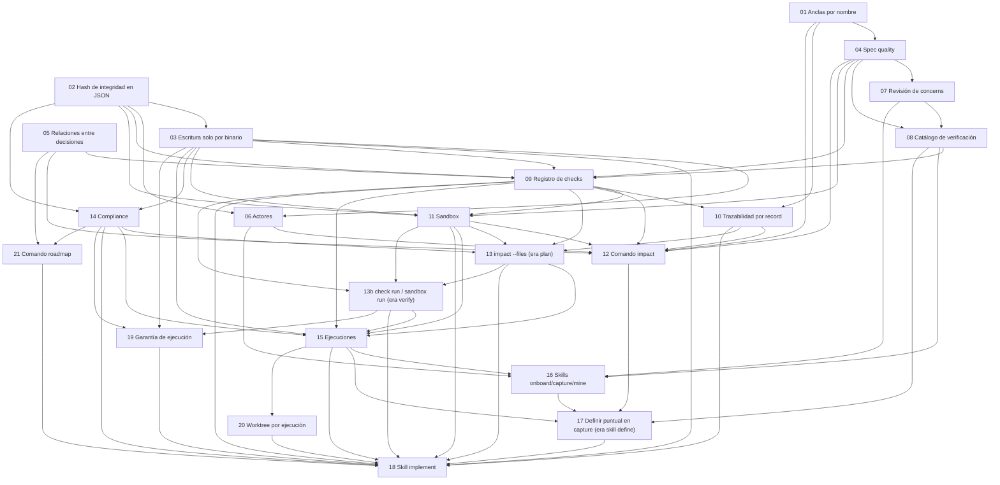

# Índice · Implementación

Este conjunto de issues lleva a openrecord de "formato y CLI para records" a "los records se implementan
solos". La idea rectora: los records son el **estado deseado**, el código es el **estado real**, y un
flujo calcula la diferencia entre los dos y la resuelve — la misma lógica que `plan` / `apply` en
herramientas de infraestructura como código, aplicada a decisiones y comportamiento en vez de a recursos
de nube. Todo lo que ese flujo necesita para funcionar sin supervisión durante la ejecución — vínculos
validados entre records, un mapa de qué verifica qué, memoria de lo ya implementado, un espacio de
trabajo aislado — pasa siempre por el binario, nunca se escribe a mano; y cuando algo exige una decisión
que nadie tomó, el flujo nunca decide por cuenta propia: se aparta como un hueco concreto y lo resuelve
una persona. Un binario determinístico aporta la estructura; una IA aporta el juicio, siempre dentro de
los límites que ese binario valida.

## Cómo se ordenaron las issues

El orden de los archivos no es arbitrario: primero dependencia (qué necesita que otra cosa exista antes),
después facilidad (lo más barato de construir, antes), y por último valor frente a costo (lo que más
desbloquea, antes que lo que solo cierra un detalle). Así, el formato (01–11) viene antes que los comandos
que lo leen (12–14), y estos antes de las ejecuciones y las skills que orquestan todo (15–18). La 13b
nació al definir la 13 (correr de verdad lo que esa lee); las tareas 19–21 nacieron después, al definir
la 14 y la 15, como refuerzos y extensiones de lo ya construido.

## Mapa de dependencias

## Checklist

Cada issue se marca como hecha solo cuando **todos** sus criterios de aceptación se cumplieron — no antes.
Una issue a medio terminar queda sin marcar, aunque ya tenga código escrito.

- [x] [01 · Anclas por nombre](01-anclas-por-nombre.md) — Depende de: — · Costo: Bajo · Valor: Alto
- [x] [02 · Hash de integridad en registros JSON](02-hash-de-integridad-en-registros-json.md) — Depende de: — · Costo: Bajo · Valor: Alto
- [x] [03 · Escritura solo por el binario](03-escritura-solo-por-binario.md) — Depende de: 02 · Costo: Medio · Valor: Alto
- [x] [04 · Spec `quality`](04-spec-quality.md) — Depende de: 01 · Costo: Medio · Valor: Alto
- [x] [05 · Relaciones entre decisiones](05-relaciones-entre-decisiones.md) — Depende de: — · Costo: Bajo · Valor: Alto
- [x] [06 · Actores](06-actores.md) — Depende de: 02, 03 · Costo: Medio · Valor: Alto
- [x] [07 · Revisión de `docs/concerns.md`](07-revision-de-concerns.md) — Depende de: 04 · Costo: Medio · Valor: Medio
- [x] [08 · Catálogo de verificación](08-catalogo-de-verificacion.md) — Depende de: 04, 07 · Costo: Alto · Valor: Alto
- [x] [09 · Registro de checks](09-registro-de-checks.md) — Depende de: 02, 03, 05, 08 · Costo: Medio · Valor: Alto
- [x] [10 · Trazabilidad con anotaciones `@record:`](10-trazabilidad-record.md) — Depende de: 01, 09 · Costo: Medio · Valor: Alto
- [x] [11 · Sandbox](11-sandbox.md) — Depende de: 04, 09 · Costo: Medio · Valor: Medio
- [x] [12 · Comando `impact`](12-comando-impact.md) — Depende de: 01, 04, 05, 06, 09, 10, 11 · Costo: Medio · Valor: Alto
- [x] [13 · `impact --files` (era `plan`)](13-comando-plan.md) — Depende de: 09, 10, 11 · Costo: Alto · Valor: Alto
- [x] [13b · `check run` / `sandbox run` (era `verify`)](13b-comando-verify.md) — Depende de: 09, 11, 13 · Costo: Alto · Valor: Alto
- [x] [14 · Registro de cumplimiento (`compliance`)](14-registro-de-implementacion.md) — Depende de: 02, 03 · Costo: Medio · Valor: Alto
- [x] [15 · Ejecuciones](15-ejecuciones.md) — Depende de: 03, 09, 11, 13, 14 · Costo: Alto · Valor: Alto
- [x] [16 · Actualizar `openrecord-onboard`, `openrecord-capture` y `openrecord-mine`](16-skills-onboard-capture-mine.md) — Depende de: 06, 07, 08 · Costo: Bajo · Valor: Medio
- [x] [17 · Definir puntual en `capture` (ya no skill `openrecord-define`)](17-skill-define.md) — Depende de: 12, 15, 16 · Costo: Medio · Valor: Alto
- [ ] [18 · Skill `openrecord-implement`](18-skill-implement.md) — Depende de: 03, 09, 10, 11, 13, 14, 15, 17 · Costo: Alto · Valor: Alto
- [ ] [19 · Garantía de ejecución de comandos](19-garantia-de-ejecucion.md) — Depende de: 03, 13b, 14 · Costo: Medio · Valor: Alto
- [ ] [20 · Worktree aislado por ejecución](20-worktree-por-ejecucion.md) — Depende de: 15 · Costo: Medio · Valor: Medio
- [ ] [21 · Comando `roadmap`](21-comando-roadmap.md) — Depende de: 05, 14 · Costo: Medio · Valor: Alto

### Leyenda

- **✔ (casilla marcada):** todos los criterios de aceptación de esa issue están cumplidos y verificados,
  no solo "en progreso".
- **Depende de:** issues que tienen que estar terminadas antes de poder empezar esta con sentido. Un
  número que aparece aquí y la issue referida todavía no tiene su casilla marcada es una señal de que se
  está adelantando trabajo fuera de orden.
- **Costo:** esfuerzo de implementación estimado (Bajo / Medio / Alto), relativo entre estas 18 issues,
  no una medida absoluta.
- **Valor:** cuánto desbloquea o cuánto resuelve por sí misma (Bajo / Medio / Alto). Ninguna de las 18
  quedó clasificada como valor Bajo.
